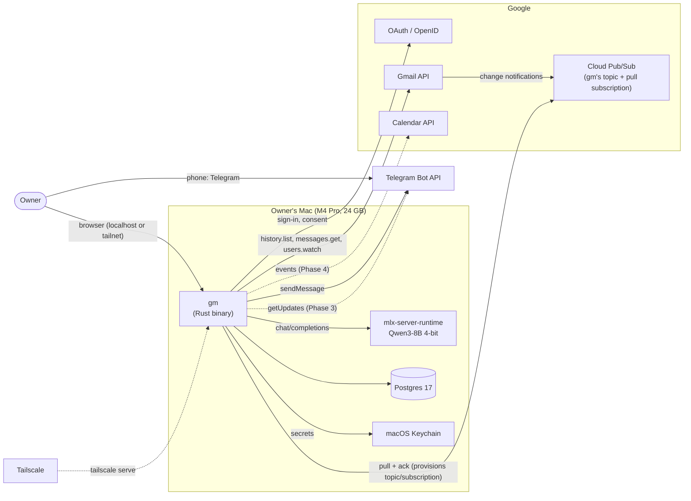
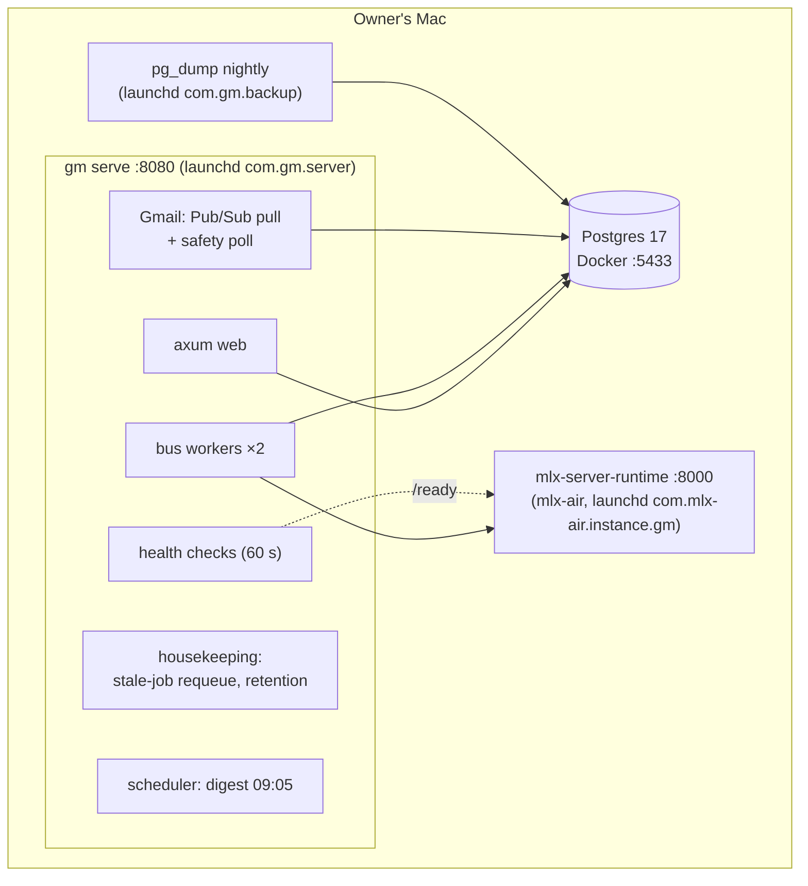
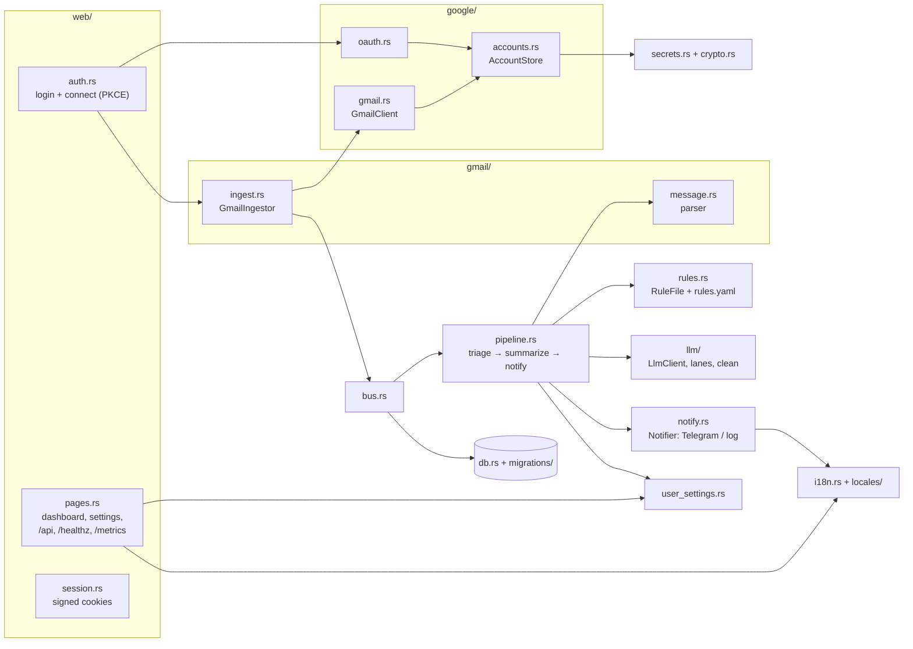
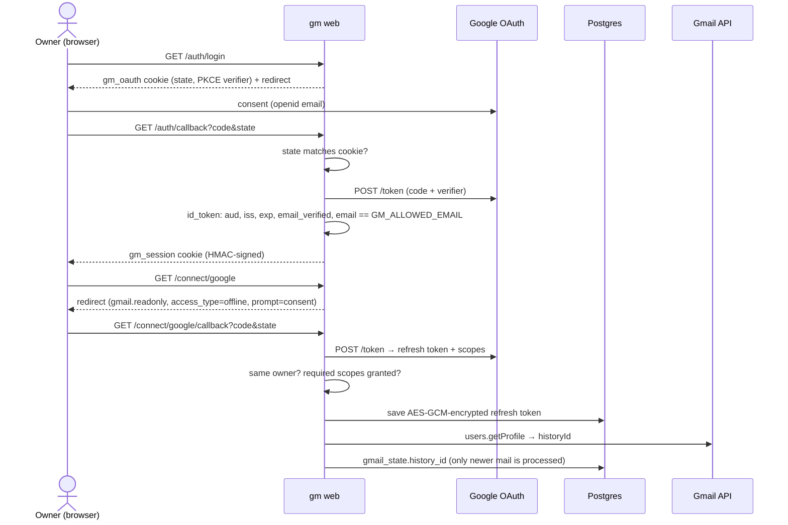
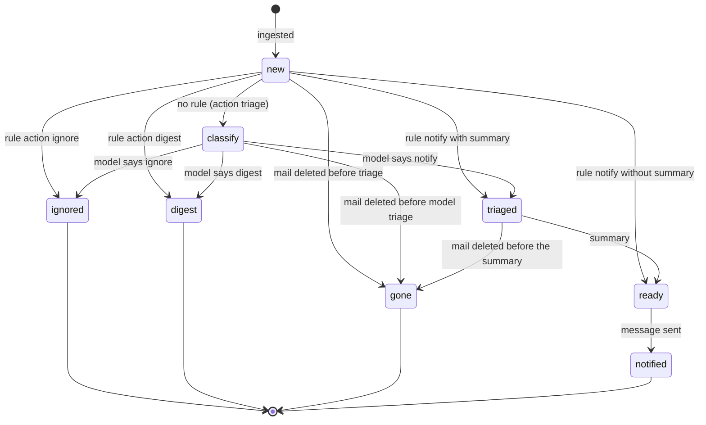
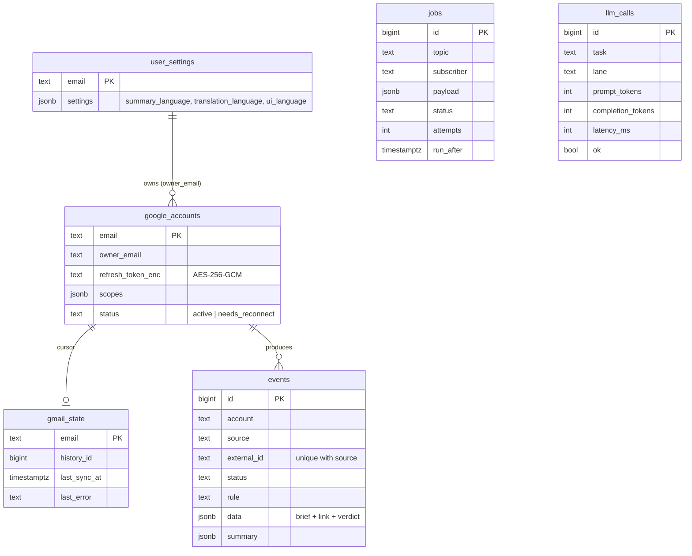
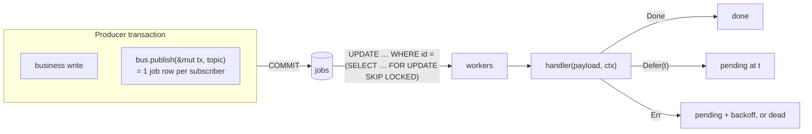
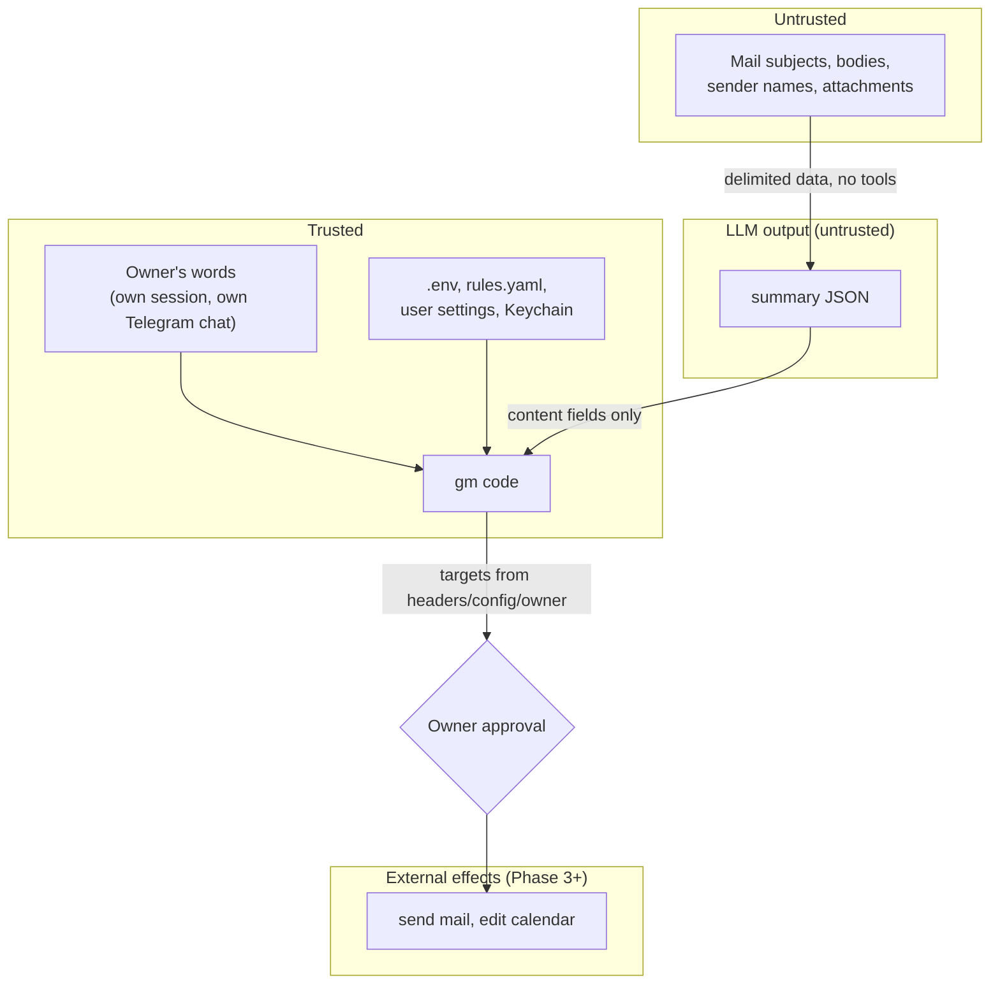
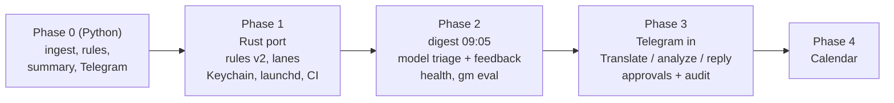

# Architecture

This document explains how Google Management is put together, at increasing levels of detail. The
diagrams use [Mermaid](https://mermaid.js.org/) and render on GitHub and in most Markdown viewers.

Legend used throughout: **solid** = exists today (Phase 1, Rust), **dashed** = planned (phase noted).

- [1. Scope and quality goals](#1-scope-and-quality-goals)
- [2. System context](#2-system-context)
- [3. Processes and deployment](#3-processes-and-deployment)
- [4. Modules inside the gm binary](#4-modules-inside-the-gm-binary)
- [5. Key flows](#5-key-flows)
- [6. State machines](#6-state-machines)
- [7. Data model](#7-data-model)
- [8. Event bus](#8-event-bus)
- [9. LLM client](#9-llm-client)
- [10. Trust boundaries](#10-trust-boundaries)
- [11. Failure modes and recovery](#11-failure-modes-and-recovery)
- [12. Evolution by phase](#12-evolution-by-phase)
- [13. Key decisions](#13-key-decisions)

## 1. Scope and quality goals

Google Management (the **gm** binary) turns changes in the owner's Google services into
notifications, a morning digest and, later, approved actions. Requirements live in the [PRD](prd.md).

Quality goals, in priority order:

1. **Safety**: no external action without approval; untrusted content can't steer actions.
2. **Privacy**: data and inference stay on the owner's Mac.
3. **Reliability**: no lost or duplicated events across crashes, restarts and sleep.
4. **Quiet**: notify only what matters; everything else waits for the digest.
5. **Simplicity**: one user, one machine, one binary.

## 2. System context



- Every connection is **outbound** from the Mac; nothing on the internet calls gm. Gmail changes
  arrive through a Pub/Sub subscription that gm **pulls**, with a safety poll every 15 minutes
  ([ADR-0002](adr/0002-gmail-ingestion-by-pull.md)); Telegram will be long-polled.
- The owner reaches the web UI on `localhost:8080`, or from the phone through `tailscale serve`
  ([ADR-0013](adr/0013-ops-launchd-keychain-tailscale.md)).

## 3. Processes and deployment



| Process | Port | Started by |
|---------|------|------------|
| `gm serve` (web + workers + poller + housekeeping) | 127.0.0.1:8080 | launchd `com.gm.server` (KeepAlive) |
| Postgres 17 | 127.0.0.1:5433 | Docker, `restart: unless-stopped` |
| mlx-server-runtime | 127.0.0.1:8000 | mlx-air (launchd `com.mlx-air.instance.gm`, KeepAlive); not managed by gm |
| Backup (`scripts/backup.sh`) | — | launchd `com.gm.backup`, 03:30 |

gm is one binary ([ADR-0009](adr/0009-rust-single-binary.md)); its background loops are tokio tasks
supervised by `app::supervise`, which restarts a crashed loop after a short delay. Install steps:
[deploy/README.md](../deploy/README.md).

## 4. Modules inside the gm binary

All code is in [`crates/gm/src/`](../crates/gm/src/). Each row below links to its file.



| Module | Responsibility |
|--------|---------------|
| [`main.rs`](../crates/gm/src/main.rs) | CLI: `serve`, `migrate`, `gen-key`, `keychain`, `rules`, `status`, `eval`. |
| [`app.rs`](../crates/gm/src/app.rs) | Wiring (`build`), background tasks under `supervise`, tracing, `serve`. |
| [`config.rs`](../crates/gm/src/config.rs) | `Config::from_env()`: non-secret settings from env/`.env`, secrets via `secrets.rs`; refuses a non-loopback bind. `from_env_without_secrets()` needs no secrets. |
| [`secrets.rs`](../crates/gm/src/secrets.rs) | Read secrets from env `GM_SECRET_<NAME>` or the Keychain (service `google-management`); `gm keychain set` stores them without putting the value in argv. |
| [`crypto.rs`](../crates/gm/src/crypto.rs) | `SecretBox`: AES-256-GCM for refresh tokens, key = Keychain `master-key`. |
| [`db.rs`](../crates/gm/src/db.rs) | sqlx pool, embedded [`migrations/`](../crates/gm/migrations/), small typed queries, retention, `system_get`/`system_set`. |
| [`bus.rs`](../crates/gm/src/bus.rs) | Durable pub/sub on Postgres (§8). |
| [`google/`](../crates/gm/src/google/) | OAuth (PKCE, id_token check), encrypted account store with access-token cache, thin Gmail REST client, Pub/Sub REST (`pubsub.rs`). |
| [`gmail/`](../crates/gm/src/gmail/) | Ingestion (bootstrap, history sync, 404 recovery, poll loop), Pub/Sub loop (watch renewal, pull, ack) and MIME parsing (charsets incl. ISO-2022-JP, HTML → text). |
| [`rules.rs`](../crates/gm/src/rules.rs) | Rules engine v2 ([ADR-0012](adr/0012-rules-engine-v2.md)): matchers, extractors, actions, examples, hot reload; `Action::as_str` / `parse_final` are the only action-name mapping. |
| [`pipeline.rs`](../crates/gm/src/pipeline.rs) | Idempotent handlers `triage`, `classify`, `summarize`, `notify`; `route` (verdict → next topic); `model_step`, the shared steps of every model job (model hours, fetch or `gone`, owner language, wait while the model is unavailable). |
| [`triage_model.rs`](../crates/gm/src/triage_model.rs) | Model triage for mail no rule covers (prompt, parse, fail-open verdict). |
| [`digest.rs`](../crates/gm/src/digest.rs) | Digest items (`summarize_item`), building, sending and late edits of the morning digest. |
| [`scheduler.rs`](../crates/gm/src/scheduler.rs) | Publishes `schedule.due` at each owner's `digest_at`; missed times fire once. |
| [`health.rs`](../crates/gm/src/health.rs) | Health checks (dead jobs, ingest lag, model `/ready`, reconnect), alerts after 15 min, recovery messages; feeds the dashboard panel, the digest System section and `/metrics`. |
| [`feedback.rs`](../crates/gm/src/feedback.rs) | 👍/👎 storage (last tap wins) and keyboard redraw. |
| [`telegram.rs`](../crates/gm/src/telegram.rs) | `getUpdates` long poll for button presses (minimal 3A). |
| [`status.rs`](../crates/gm/src/status.rs) | `gm status`: launchd agents, running build, endpoints, model name, migrations and queue, read from the live Mac; reuses the health checker's queries. |
| [`eval.rs`](../crates/gm/src/eval.rs) | Local eval set files and `gm eval` (runs rules → triage → the summary `Pipeline::route` picks). |
| [`llm/`](../crates/gm/src/llm/) | The only way to call a model (§9). |
| [`notify.rs`](../crates/gm/src/notify.rs) | `Notifier` trait; Telegram (plain text, silent flag, buttons, edits), log, recording (tests); notification formatting. |
| [`user_settings.rs`](../crates/gm/src/user_settings.rs) | Per-user settings with validation; `tr(email)` gives UI strings in the owner's language. |
| [`i18n.rs`](../crates/gm/src/i18n.rs) | Fluent strings for en / vi / ja ([`locales/`](../crates/gm/locales/)). |
| [`clock.rs`](../crates/gm/src/clock.rs) | `Clock` (system or fixed in tests) and `ModelHours`. |
| [`web/`](../crates/gm/src/web/) | axum router (`mod.rs`), host/origin guard, owner session, askama pages (`pages.rs`, [`templates/`](../crates/gm/templates/)). |

## 5. Key flows

### 5.1 Sign-in and connecting Gmail

Two OAuth flows against the same Google client, both with PKCE and a signed state cookie:
one only proves identity, the other grants offline Gmail access.



### 5.2 New mail → notification or digest

```mermaid
sequenceDiagram
    participant I as GmailIngestor
    participant GM as Gmail API
    participant DB as Postgres
    participant B as Bus worker
    participant L as LLM
    participant T as Telegram

    loop on Pub/Sub notification (pulled), safety poll, or manual sync
        I->>GM: history.list(startHistoryId = cursor)
        I->>DB: BEGIN; insert events (dedupe); publish gmail.message.received; cursor = GREATEST; COMMIT
    end
    B->>GM: messages.get (format=full)
    B->>B: parse + evaluate rules.yaml → verdict
    opt no rule matched (action triage)
        B->>DB: status classify + publish gmail.message.classify
        B->>L: model triage (notify lane, deferred at night / outage like summaries)
        B->>B: verdict {rule: model, action, reason}; continue as below
    end
    alt ignore / digest
        B->>DB: status ignored / digest
    else notify without summary (e.g. card flash)
        B->>DB: status ready + publish notify.email
    else notify with summary
        B->>DB: status triaged + publish gmail.message.summarize
        alt night (19:00–09:00)
            B->>DB: Defer until 09:00 (attempt not counted)
        else model unavailable (down, timeout, 429/5xx)
            B->>DB: Defer 5 min (attempt not counted)
        else model hours
            B->>L: summary (notify lane)
        end
        B->>DB: summary, status ready + publish notify.email
    end
    B->>T: sendMessage (plain text; silent for priority silent)
    B->>DB: status notified
```

Night and outage rules ([ADR-0015](adr/0015-notification-policy-and-digest.md)): rule-only notifications go out at any hour; anything that needs the LLM waits for model hours
and for the model to answer, urgent included. No ping is sent without its summary; a real LLM error
leaves the job `dead`. The body is re-fetched in each step rather than stored.

### 5.3 Morning digest (Phase 2)

At 09:00 the model loads, overnight `digest` events are summarized in the `batch` lane
(`digest.item.summarize`), and at the user's `digest_at` (09:05) the scheduler publishes
`schedule.due{digest}`. The builder claims the unsent `digest` events (`events.digest_id`), groups
them by rule `section` in rule order with the model-triaged ones last, and sends one silent message.
Items not summarized yet go out as titles; when their summary arrives the same day before 19:00,
`digest.refresh` edits the message. Nothing is sent on an empty day. Format:
[interfaces](spec/interfaces.md#digest-phase-2).

### 5.4 Owner instruction → approval → execution (Phase 3)

Unchanged from [ADR-0003](adr/0003-intent-router-before-agent.md): an intent router that sees only
the owner's words, fixed recipes (translate, analyze, reply), immutable approvals with a payload hash,
and an executor that re-checks the live draft before sending. Details: [phase 3 plan](plan/phase-3.md).

## 6. State machines

### Event (`events.status`)



Model triage (`classify`) follows the same night and outage rules as summaries.

### Job (`jobs.status`)

```mermaid
stateDiagram-v2
    [*] --> pending: published
    pending --> running: claimed (SKIP LOCKED)
    running --> done: Outcome::Done
    running --> pending: Outcome::Defer(t), attempt not counted
    running --> pending: error, attempts left (backoff)
    running --> dead: error on last attempt
    running --> pending: stale > 10 min, or at startup
    done --> [*]
```

## 7. Data model

Full column lists: [data model spec](spec/data-model.md).



## 8. Event bus

A small durable pub/sub on a Postgres table ([ADR-0001](adr/0001-postgres-durable-bus.md)).



- **Atomic publish (outbox)** and **at-least-once delivery**: every handler re-checks state first.
- **Retry:** 5 s × 2^(n−1), capped at 900 s; `GM_JOB_MAX_ATTEMPTS` (5); then `dead` with `last_error`.
  Handlers can read `ctx.is_last_attempt()` to degrade instead of failing.
- **Defer:** a handler can postpone a job (model hours) without using an attempt.
- **Crash recovery:** all `running` jobs are requeued at startup; every 5 min, jobs running > 10 min.

Topic catalog: [events spec](spec/events.md).

## 9. LLM client

All model calls go through `llm::LlmClient` ([ADR-0010](adr/0010-llm-client-lanes-residency.md)):

- **Admission with lanes:** `interactive` > `notify` > `batch`, at most `GM_LLM_MAX_INFLIGHT` (2)
  requests in flight; a waiting higher lane is always admitted first.
- **Prompt shape for prefix caching:** `system.md` + task prompt + `/no_think` form a stable system
  message; the user message carries the output language and then the mail in `<email>` delimiters,
  last. Prompts live in `crates/gm/prompts/`.
- **Input control:** quoted replies, "On … wrote:" blocks and signatures are removed; the body is
  capped at `GM_LLM_MAX_INPUT_TOKENS` (2,000, CJK counted as 1 token per character).
- **Output:** JSON requested in the prompt; tolerant parse; one retry with a reminder; then the raw
  text is kept with `parse_ok=false`. No `tools` / `response_format` (the runtime has neither).
- **Accounting:** every call writes `llm_calls` (task, lane, model, tokens, latency, ok); `/metrics`
  exposes 24 h totals per lane.
- **Model hours:** gm runs model work 09:00–19:00 only and defers it otherwise
  (`Pipeline::model_step` in [`pipeline.rs`](../crates/gm/src/pipeline.rs)). The model process is
  mlx-air's: gm never starts or stops it. Model: Qwen3-8B 4-bit now, Bonsai-27B 1-bit later
  ([ADR-0011](adr/0011-model-qwen3-8b-now-bonsai-later.md)).

## 10. Trust boundaries



1. Untrusted content only reaches a model as delimited data, and that model has no tools.
2. Model output fills content fields; it never chooses a target.
3. Every external effect passes an approval showing exactly what will happen.

Details: [security spec](spec/security.md).

## 11. Failure modes and recovery

| Failure | What happens | Recovery |
|---------|-------------|----------|
| Mac sleeps / gm stopped | No ingestion | On start, sync from the stored cursor (Gmail keeps about a week of history); queued Pub/Sub messages are pulled. |
| Pub/Sub down, scope missing, watch expired | No notifications | Dashboard shows the error; polling returns to every 60 s; the loop retries with backoff and renews the watch. |
| Crash mid-handler | Job stuck `running` | Requeued at startup / after 10 min; handlers are idempotent. |
| Model not running, timeout, `429`/`5xx` | `summarize` defers | Queued: retried every 5 min without using attempts; nothing is sent until the summary exists. |
| Night | `summarize` defers | Waits for 09:00; rule-only notifications still go out. |
| Other LLM error (e.g. 400) | `summarize` fails | Backoff retries, then the job is `dead` (dashboard, `/metrics`); no ping. |
| LLM returns bad JSON | — | One retry with a reminder, then raw text with `parse_ok=false`. |
| Telegram down | `notify` fails | Backoff; `dead` after 5 attempts (visible in `/metrics` and the dashboard counts). |
| Refresh token revoked | Google returns `invalid_grant` | Account → `needs_reconnect`; dashboard asks to reconnect; ingestion skips it. |
| History cursor too old | `history.list` 404 | Re-anchor and recover INBOX `newer_than:2d` (max 50), deduplicated. |
| Mail deleted before triage | `messages.get` 404 | Event → `gone`. |
| Invalid `rules.yaml` edit | Parse error | Previous rules stay active; the error is logged. `gm rules` checks it first. |
| Postgres down | Everything stalls; `/healthz` 503 | Docker restarts it; nightly dumps for restore. |

## 12. Evolution by phase



| Concern | Phase 1 | Phase 2 | Phase 3 | Phase 4 |
|---------|---------|---------|---------|---------|
| Triage | rules v2; unmatched → notify | + model triage, 👍/👎 feedback | same | same |
| Output | Telegram notifications | + digest at 09:05, health alerts | + buttons, replies | + calendar notices |
| LLM | summary (notify lane) | + batch lane, triage, digest items, `gm eval` | + interactive lane, thinking for reply/analyze | same |
| Scopes | `gmail.readonly` | same | + `gmail.compose` | + `calendar.readonly` |
| Owner → system | web dashboard, settings | same | Telegram buttons and replies | same |

Backlog: expense ledger (Sheets), Drive, free-form agent and automations, Bonsai-27B.

## 13. Key decisions

Significant decisions are recorded as ADRs ([index](adr/README.md), 0001–0017); smaller choices are
written into the spec or doc they govern.
